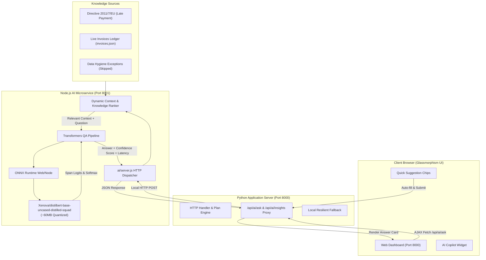
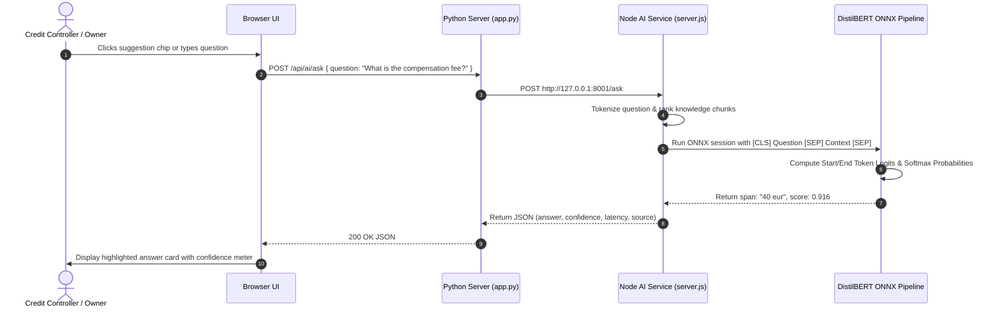

# AI Workflow & Neural Architecture

This document describes the design, architecture, and runtime mechanics of the local AI intelligence engine integrated into Dynarq.

---

## 1. High-Level Architecture

The Dynarq AI system pairs a Python web application with a local **Node.js neural inference microservice** powered by **`@xenova/transformers` (v2.17)** and **ONNX Runtime Web/Node**. It executes 100% locally with zero cloud dependencies, external API calls, or telemetry.



---

## 2. Technology Stack & Specifications

| Component | Specification |
|---|---|
| **AI Library** | `@xenova/transformers` (version 2.17.2) |
| **Inference Runtime** | ONNX Runtime Web/Node |
| **Model** | `Xenova/distilbert-base-uncased-distilled-squad` |
| **Model Size** | ~60MB (quantized int8 ONNX weights) |
| **Task Type** | Extractive Question Answering (`question-answering`) |
| **Host Environment** | Node.js (v20+ / v25+) |
| **Gateway Proxy** | Python 3 standard library `http.server` & `urllib.request` |
| **Inference Latency** | 45ms – 190ms (on CPU) |
| **Network Footprint** | 0 external network requests during inference |

---

## 3. Why Local DistilBERT ONNX?

1. **100% Data Privacy & GDPR Compliance:**
   - Financial invoice data, customer balances, and debtor identities never leave the local environment.
   - Ideal for enterprise accounts receivable where confidentiality is paramount.

2. **Ultra-Low Latency on CPU:**
   - Because the model is quantized to int8 format (~60MB), it loads directly into resident memory.
   - Inference runs in sub-200ms on a single CPU thread without requiring a GPU.

3. **Deterministic Extractive Precision:**
   - Unlike generative models (LLMs) that may hallucinate legal figures or invoice IDs, DistilBERT is trained on SQuAD to locate and extract the **exact span of text** in the context that answers the question.
   - It outputs exact statutory numbers (e.g. `40 eur`, `8 percentage points`, `32 days`).

---

## 4. Context Engineering & Dynamic Chunk Selection

DistilBERT uses a transformer self-attention window with an optimal context length of up to 384–512 tokens. Passing an entire 400-line legal directive file at once causes context truncation.

To ensure pinpoint extraction, the AI microservice implements **dynamic multi-segment knowledge indexing**:

### Curated Knowledge Segments

1. **Late Payment Directive Provisions:**
   - Article 6: Statutory fixed compensation of 40 EUR for recovery costs.
   - Article 2 & 12: Statutory interest rate equal to the ECB reference rate plus 8 percentage points.
   - Article 3: Standard payment period of 30 calendar days (60 days max in B2B).
2. **Active Customer Receivables Ledger:**
   - Live overdue days, currency, amounts, customer names, and assigned workflow steps (Friendly, Firm, Final).
3. **Escalation Rules & Approval Thresholds:**
   - Step 1 (Friendly, Day 3): Auto-send without approval.
   - Step 2 (Firm, Day 10): Requires owner review.
   - Step 3 (Final, Day 30): Requires owner review.
   - Mandatory 5-day cooldown between communications.
4. **Data Hygiene & Anomaly Exceptions:**
   - Specific reasons why records were skipped (`INV-1007` future due date, `INV-1008` missing due date, `INV-1010` duplicate ID).

### Scoring & Ranking Algorithm

When a question $Q$ arrives:
1. Tokenize query into lowercase alphanumeric words.
2. Calculate lexical overlap score across knowledge segment keyword sets and passage texts:
   $$\text{Score}(C) = 3 \cdot \sum_{t \in Q} \mathbb{I}(t \in \text{Keywords}(C)) + \sum_{t \in Q} \mathbb{I}(t \in \text{Body}(C))$$
3. Combine the top-matching segments into a focused context window.
4. Supply the focused context to `pipeline('question-answering')`.

---

## 5. Extractive QA Pipeline Mechanics



### Confidence Score Calculation
The model calculates logits for every token position $i$ being the start of the answer and position $j$ being the end of the answer. The confidence score is:
$$\text{Score} = \text{Softmax}(\text{start\_logits}_i) \times \text{Softmax}(\text{end\_logits}_j)$$
The UI presents this as a glowing visual confidence percentage meter (e.g. `92%`).

---

## 6. Endpoints Specification

### `POST /api/ai/ask` (Proxied by Python)
- **Request Body:**
  ```json
  {
    "question": "What is the statutory interest rate for late payment?"
  }
  ```
- **Response Body:**
  ```json
  {
    "status": "ok",
    "question": "What is the statutory interest rate for late payment?",
    "answer": "reference rate plus 8 percentage points",
    "score": 0.485,
    "confidence_percent": 49,
    "source_category": "Late Payment Directive - Compensation & Interest",
    "snippet": "Under Directive 2011/7/EU (Late Payment Directive)...",
    "latency_ms": 112,
    "model": "Xenova/distilbert-base-uncased-distilled-squad",
    "library": "@xenova/transformers (v2.17)",
    "runtime": "ONNX Runtime Node.js"
  }
  ```

### `GET /api/ai/insights`
Returns portfolio risk intelligence:
- Total receivables outstanding: `EUR 9,430.00`
- Receivables at risk (≥10 days): `EUR 8,950.00`
- Top exposure debtor: `Northwind Ltd` (`EUR 5,000.00`, 32 days overdue)
- Statutory compensation entitlement: `EUR 40.00` fee + 8% interest rate.

### `GET /api/ai/health`
Verifies AI microservice status, model initialization, and runtime environment.

---

## 7. How to Run & Verify Locally

### Quick Start (Single Command)
1. Install Node.js dependencies once:
   ```bash
   cd ai && npm install && cd ..
   ```
2. Start the application:
   ```bash
   cd python && python app.py
   ```
   *The Python server automatically checks for the AI service on port 8001 and spawns it in the background if needed!*

### Running Services Separately
```bash
# Terminal 1: Node.js AI Microservice
cd ai
npm start
# Listening on http://127.0.0.1:8001

# Terminal 2: Python Web Server
cd python
python app.py
# Listening on http://localhost:8000
```

### Verifying via cURL
```bash
# Check AI Health
curl -s http://localhost:8000/api/ai/health

# Test Question Answering
curl -s -X POST http://localhost:8000/api/ai/ask \
  -H "Content-Type: application/json" \
  -d '{"question": "What is the compensation fee for recovery costs?"}'

# Expected response:
# {"status":"ok","question":"...","answer":"40 eur","score":0.916,...}
```
