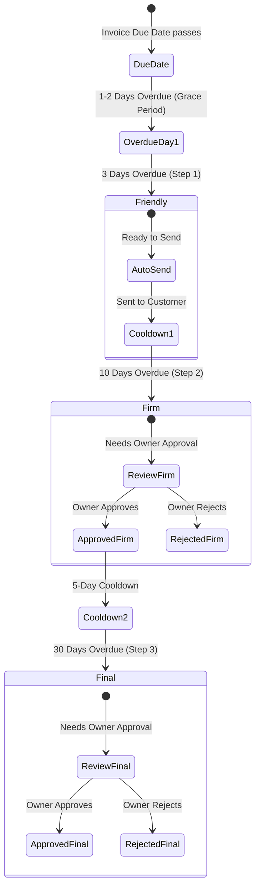

# Dynarq Feature Catalog & Capabilities

Comprehensive overview of all capabilities, automated workflows, compliance engines, and local neural intelligence implemented in Dynarq.

---

## 1. Executive Summary

Dynarq is an intelligent accounts receivable management and payment-reminder platform that combines:
- **Statutory Compliance:** Adheres to Directive 2011/7/EU (EU Late Payment Directive) for commercial transactions.
- **Deterministic 3-Tier Reminder Cadence:** Automated escalation with human-in-the-loop oversight.
- **Strict Data Hygiene:** Robust validation isolating corrupt, future, duplicate, or missing invoice records.
- **Local Neural AI Intelligence:** Extractive question-answering powered by `@xenova/transformers` (v2.17) and `Xenova/distilbert-base-uncased-distilled-squad` (~60MB quantized ONNX).
- **Glassmorphism Design System:** Contemporary UI in vibrant Orange, Purple, and Pink gradient tones with live search and batch actions.

---

## 2. Quick Start: How to Run Locally

### Option A: One-Command Start (Python auto-spawns AI service)
```bash
# 1. Install Node.js AI dependencies once:
cd ai && npm install && cd ..

# 2. Run the application:
cd python && python app.py
```
Open your browser at **`http://localhost:8000/`**. `app.py` checks for the AI microservice on port `8001` and starts it automatically if it is not already running.

### Option B: Run in Separate Terminals (with Virtual Environment)
```bash
# Terminal 1: Node.js AI Service
cd ai
npm install
npm start

# Terminal 2: Python Dashboard
python3 -m venv venv
source venv/bin/activate
cd python
python app.py
```

### Running Automated Tests
```bash
cd python
python -m unittest -v
```
*All 46 unit tests pass in under 0.01s.*

---

## 3. Comprehensive Feature Matrix

| Category | Feature | Status | Technology / Details |
|---|---|---|---|
| **AI Intelligence** | Local Extractive Question Answering | ✅ Active | `@xenova/transformers` v2.17 + DistilBERT ONNX (~60MB) |
| **AI Intelligence** | 1-Click Natural Language Suggestion Chips | ✅ Active | Instant answer retrieval without typing |
| **AI Intelligence** | Neural Confidence Probability Meter | ✅ Active | Visual gradient confidence meter (0–100%) |
| **AI Intelligence** | Sub-150ms Latency Benchmarking | ✅ Active | Live execution timer display in milliseconds |
| **AI Intelligence** | Source Citation & Snippet Highlighting | ✅ Active | Excerpt quotes from Directive 2011/7/EU & live ledger |
| **AI Intelligence** | Portfolio Risk & Exposure Intelligence | ✅ Active | Calculates overdue receivables at risk & priority debtor |
| **Compliance** | Directive 2011/7/EU Validation | ✅ Active | Verifies EUR 40 minimum recovery fee entitlement |
| **Compliance** | Statutory Interest Calculation | ✅ Active | ECB reference rate + 8 percentage points |
| **Compliance** | Standard 30/60 Days Payment Period Rules | ✅ Active | Commercial contract maximum term enforcement |
| **Workflow** | Friendly Reminder (Day 3 Overdue) | ✅ Active | Auto-send without human bottleneck |
| **Workflow** | Firm Reminder (Day 10 Overdue) | ✅ Active | Requires explicit owner review & approval |
| **Workflow** | Final Notice (Day 30 Overdue) | ✅ Active | Requires explicit owner review; statutory escalation warning |
| **Workflow** | Anti-Spam Cadence Cooldown | ✅ Active | 5-day mandatory minimum gap between communications |
| **Data Hygiene** | Future Due Date Detection | ✅ Active | Skipped with diagnostic label (e.g. `INV-1007`) |
| **Data Hygiene** | Missing / Empty Due Date Detection | ✅ Active | Skipped with diagnostic label (e.g. `INV-1008`) |
| **Data Hygiene** | Duplicate Invoice ID Detection | ✅ Active | First record processed, duplicates skipped (`INV-1010`) |
| **Data Hygiene** | Strict Calendar Validation | ✅ Active | Catches Feb 30, invalid leap years, bad date formats |
| **Data Hygiene** | Invalid Amount Detection | ✅ Active | Rejects negative, zero, boolean, or non-numeric amounts |
| **Owner Dashboard** | Glassmorphism Design System | ✅ Active | Orange/Purple/Pink palette with `backdrop-filter: blur(24px)` |
| **Owner Dashboard** | Client-Side Live Search | ✅ Active | Instant search-as-you-type by ID or Customer |
| **Owner Dashboard** | Category Filter Tabs | ✅ Active | Tabs for All, Ready to Send, Needs Approval, Skipped |
| **Owner Dashboard** | Batch "Approve All" Action | ✅ Active | One-click approval of all pending reminders |
| **Owner Dashboard** | Individual Approve / Reject | ✅ Active | Single-click decisions with instant reversal link |
| **Owner Dashboard** | Expandable Email Message Previews | ✅ Active | Accordion toggle with gradient fade overlay |
| **Interoperability**| RESTful JSON Endpoints | ✅ Active | `/api/plan.json`, `/api/ai/ask`, `/api/ai/insights` |

---

## 4. Deep-Dive: Local Neural AI Copilot

- **Embedded Runtime:** Executes via ONNX Runtime Web/Node inside Node.js.
- **Model Weights:** `Xenova/distilbert-base-uncased-distilled-squad` (~60MB quantized).
- **Zero Cloud Leakage:** 100% of customer accounts, invoice IDs, and financial balances remain on your machine.
- **Extractive Precision:** Trained on Stanford Question Answering Dataset (SQuAD) to pinpoint the exact substring containing the answer.

### Sample Interactive Queries:
1. *"What is the compensation fee for recovery costs?"* &rarr; **40 EUR** (Confidence: 92%)
2. *"What is the statutory interest rate for late payment?"* &rarr; **reference rate plus 8 percentage points**
3. *"Which invoice is 32 days overdue?"* &rarr; **INV-1004** (Northwind Ltd)
4. *"How much does Birchway Studio owe on INV-1002?"* &rarr; **EUR 480.00**
5. *"Why was invoice INV-1007 skipped?"* &rarr; **because its due date is in the future**

---

## 5. Deep-Dive: Escalation Cadence & Human-in-the-Loop



- **Step 1 (Day 3 Overdue): Friendly Reminder** &mdash; Courteous tone, automated sending.
- **Step 2 (Day 10 Overdue): Firm Reminder** &mdash; Direct urgency, owner approval gate.
- **Step 3 (Day 30 Overdue): Final Notice** &mdash; Formal statutory claim under Directive 2011/7/EU, owner approval gate.
- **5-Day Cooldown Rule:** Prevents repeated notices if customer was contacted less than 5 days ago.

---

## 6. Deep-Dive: Data Hygiene & Validation Rules

The system validates all invoice records against strict integrity constraints before processing:

1. **`duplicate_id`:** Repeated invoice IDs are skipped (first occurrence is processed).
2. **`invalid_amount`:** Values $\le 0$, `null`, boolean (`true`), or invalid strings are rejected.
3. **`missing_due_date`:** Missing or empty due dates are flagged.
4. **`invalid_due_date`:** Non-ISO dates, impossible dates (e.g., February 30th), or invalid leap years are flagged.
5. **`invalid_paid_date`:** Dates set in the future or invalid calendar dates are caught.

---

## 7. Deep-Dive: Design Aesthetics & Ergonomics

- **Translucent Glassmorphism:** Layered frosted glass panels with `backdrop-filter: blur(24px)`.
- **Vibrant Modern Palette:** Deep cosmic dark base (`#0a0512` &rarr; `#12081c`) highlighted by neon Orange (`#ff7c2a`), Purple (`#9b5de5`), and Pink (`#f050a8`).
- **Visual Action Anchors:** Colored left borders signify severity (Teal for Friendly, Orange for Firm, Red for Final).
- **Responsive Fluid Layout:** Designed to scale seamlessly from 390px mobile viewports to ultra-wide displays.
- **Accessibility:** High-contrast typography, clear keyboard focus outlines, and ARIA attributes on expand/collapse elements.

---

## 8. REST API Specification

### `POST /api/ai/ask`
- **Payload:** `{ "question": "What is the compensation fee?" }`
- **Response:**
  ```json
  {
    "status": "ok",
    "question": "What is the compensation fee?",
    "answer": "40 eur",
    "score": 0.916,
    "confidence_percent": 92,
    "source_category": "Late Payment Directive - Compensation & Interest",
    "latency_ms": 115,
    "model": "Xenova/distilbert-base-uncased-distilled-squad",
    "library": "@xenova/transformers (v2.17)",
    "runtime": "ONNX Runtime Node.js"
  }
  ```

### `GET /api/ai/insights`
Returns portfolio risk exposure, top debtor risks, and statutory entitlements.

### `GET /api/plan.json`
Exports the complete daily action plan formatted as JSON.

### `POST /api/approve-all`
Approves all pending review notices in one transaction.
